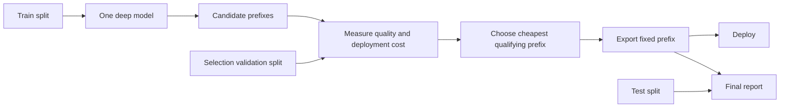

# Prefix Optimised Depth Selection (PODS)

The starting idea was to ask whether one deep model could provide several fixed, independently deployable depth choices. PODS trains those choices together, measures their quality and deployment cost, and selects one prefix offline for a stated quality target.

## AI Statement
I had an idea. 
AI implemented it.
I reviewed.

## The idea

Train a model with an output layer at each depth and track loss/accuracy through training.
At inference time, select which one is needed based on the accuracy/compute tradeoff.

A deep model can expose a prefix at each candidate depth. For candidate depths \(D = \{d_1, \ldots, d_K\}\), let \(f_{\leq d}\) be the first \(d\) backbone blocks and let \(h_d\) be the prediction head attached at that depth:

$$
z_d(x) = h_d\left(f_{\leq d}(x)\right), \qquad d \in D.
$$

The model is trained at several depths during one run. Its multi-depth objective is a weighted average of the losses at the selected depths:

$$
\mathcal{L} = \frac{\sum_{d \in D} w_d\mathcal{L}_d}{\sum_{d \in D} w_d},
\qquad
w_d = \left(\frac{d}{d_{\max}}\right)^p.
$$

Training uses the training split. A seeded validation split is used to compare prefixes. The test split is held back for final reporting. For each candidate depth, the experiment records a quality value \(q(d)\) and a measured deployment cost \(c(d)\), such as latency, peak memory, throughput, or serialised model size.

The default selection rule chooses the cheapest measured prefix that remains within an allowed quality drop from the full model:

$$
d^* = \arg\min_{d \in D:\;q(d) \geq q(d_{\max}) - \delta} c(d).
$$

The deployed model is the fixed prefix \(h_{d^*} \circ f_{\leq d^*}\). Selection happens offline, so inference does not need a controller, an early-exit decision, or the unused deeper layers.



PODS is static offline prefix selection. It is not dynamic early exit. It does not claim that prefixes universally beat naive truncation or independently trained shallow models.

## Experimental / WiP state

The status below follows the documented [milestone validation record](pods/docs/milestone_validation.md). Raw and processed result artefacts are absent from the current checkout, so the numerical examples are reported historical evidence rather than fresh local verification.

### What has been done

| Area | Documented state |
| --- | --- |
| Machinery | Prefix-logit parity, CUDA cost measurement, config reproducibility, and MNIST sanity validation are complete. |
| CIFAR evidence | CIFAR-10 and CIFAR-100 ResNet studies include PODS, naive truncation, independent shallow baselines, and frontier plots. |
| Transformer proof | BERT and RoBERTa wrappers, GLUE handling, shallow baselines, LayerDrop, and direct extracted-prefix benchmarking are complete. |
| BERT-first GLUE sweep | Six tasks, three main variants, three seeds, and 54/54 documented runs are complete. |
| Full research programme | Work remains beyond the chosen BERT-first milestone scope. |

The CIFAR milestone was accepted by explicit override because CIFAR-100 did not beat naive truncation. The strict transformer proof and the chosen BERT-first Milestone 4 sweep are closed under their stated scopes.

### What was found

The one-run-to-many-prefix deployment mechanism works. Prefix quality and measured deployment cost can be compared before exporting one fixed deployable prefix.

The empirical result is mixed. On CIFAR-10, `pods_sandwich` reached reported accuracy `0.5228` against `0.4929` for naive truncation. On CIFAR-100, both main PODS variants reported `0.1423` against `0.1538` for naive truncation.

Shallower selection is selective rather than universal. `qqp:bert:pods_all` selected depth `8` for all three seeds. `cola:bert:pods_all` selected depth `10`. The main `qnli` variants selected full depth `12`, and naive truncation remains competitive in the reported GLUE comparisons. The complete task-by-task values remain in the [milestone validation record](pods/docs/milestone_validation.md).

### What is missing

- real STS-B evidence;
- real MNLI evidence;
- completed progressive-shrinking experiments;
- completed distilled-shallow experiments;
- broader RoBERTa comparator coverage;
- the full manuscript and generated submission package;
- local raw and processed result artefacts if independent checkout-level verification is required.

## Environment

This repo uses `uv` as the primary Python environment and dependency manager.

Requirements:

- Python 3.11 or newer
- `uv`
- NVIDIA GPU with CUDA support for ML runs

Bootstrap the environment with:

```bash
uv lock
uv sync --extra dev
```

Verify that the environment is GPU-backed before running any experiment:

```bash
uv run python -c "import torch; print({'torch_version': torch.__version__, 'cuda_available': torch.cuda.is_available(), 'cuda_version': torch.version.cuda, 'device_count': torch.cuda.device_count(), 'device_name': torch.cuda.get_device_name(0) if torch.cuda.is_available() else None})"
```

PODS ML experiments are GPU-only. CPU-only PyTorch environments are unsupported for training and benchmarking.

The canonical dependency files are:

- `pyproject.toml`
- `uv.lock`

Stage 1 does not use `environment.yml`.

## Development

Run the behavioural test suite with:

```bash
uv run pytest -q
```

Run the first sanity experiment with:

```bash
uv run python -m pods.run --config pods/configs/sanity/mnist_mlp.yaml
```

Generate the tracked review figure pack from processed summaries with:

```bash
uv run python -m pods.eval.review_figures
```

Export manuscript-ready summary tables from processed summaries with:

```bash
uv run python -m pods.eval.export_paper_assets
```

Diff the tracked GLUE config surface against completed raw runs with:

```bash
uv run python -m pods.experiments.matrix_status
```

For environment workflow notes and dependency update policy, see [pods/docs/development_environment.md](pods/docs/development_environment.md).

Current work tracking docs:

- [Session 5 handover](pods/docs/session5_handover_2026-04-28.md)
- [Session 4 handover](pods/docs/session4_handover_2026-04-28.md)
- [Session 3 handover](pods/docs/session3_handover_2026-04-27.md)
- [Session 2 handover](pods/docs/session2_handover_2026-04-26.md)
- [Session 2 TODO](pods/docs/session2_todo.md)
- [Milestone validation](pods/docs/milestone_validation.md)
- [Paper assembly notes](pods/docs/paper_assembly_notes.md)

Current position:

- the strict transformer-proof milestone is now complete
- the chosen BERT-first Milestone 4 sweep is now complete
- the six-task BERT main matrix is complete across `sst2`, `mrpc`, `rte`, `qqp`, `qnli`, and `cola`
- the `qqp`, `qnli`, and `cola` baseline block is complete
- a one-off local figure pack now exists under `temp/analysis_figures/` for result review, including frontier, trade-off, and Pareto-style plots
- the current next-step decision is whether to move into paper assembly from the BERT-first evidence base or reopen the deferred RoBERTa comparator work


